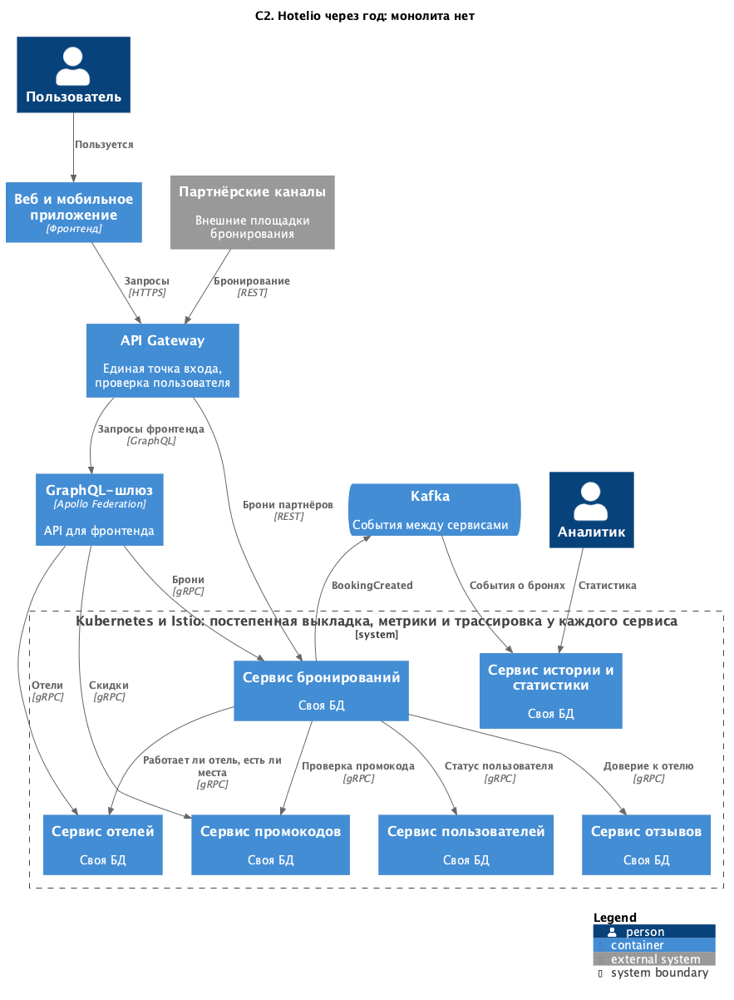

### **Название задачи: Целевая архитектура Hotelio и состояние через два месяца**
### **Автор: Никита Соловьёв**
### **Дата: 12.10.2026**

### **Проблема**
Бронирование отелей, около 1 млн пользователей, основной трафик на поиск и бронирование. Всё в одном Spring Boot
приложении с одной базой, бэкенд пишут три человека.

Проблемы из постановки:
1. Сложно сопровождать, любая правка требует знать весь код.
2. Бронирование нельзя масштабировать отдельно, хотя пик нагрузки на нём.
3. Команды не могут выпускаться независимо, быстрого CI/CD нет.
4. REST монолита неудобен фронтенду, BFF нет.
5. Новые фичи рискованные, тестировать приходится всё.

Что нашёл сам, проверки в `test-log.txt`:

6. `BookingService` синхронно вызывает четыре модуля, и все работают с одной базой. Отсюда растут проблемы 1, 2 и 5.
7. `ddl-auto: create`, перезапуск монолита стирает все данные.
8. Расчёт брони. Цена не зависит от отеля, база 100 или 80 для VIP зашита в коде. Скидка промокода вычитается суммой,
VIP с промокодом на 10 платит 70. Срок промокода не проверяется, дата брони не заполняется.
9. Нет аутентификации, `GET /api/bookings` без `userId` отдаёт брони всех пользователей.
10. Отказ в брони приходит как 500, клиент не отличит его от падения сервера.
11. Документация API расходится с кодом.

### **Функциональные требования**

|**№**|**Действующие лица или системы**|**Use Case**|**Описание**|
| :-: | :- | :- | :- |
|1|Пользователь, сервис отелей|Поиск отелей|По городу и рейтингу|
|2|Пользователь, сервис бронирований|Создание брони|Проверки пользователя, отеля, отзывов и промокода, расчёт цены, сохранение|
|3|Пользователь|Свои брони|Видит только свои|
|4|Пользователь, сервис промокодов|Проверка промокода|Действует ли и подходит ли этому пользователю|
|5|Пользователь, сервис отзывов|Отзывы|Отзывы и доверие к отелю, без доверия бронировать нельзя|
|6|Аналитик, сервис истории|Статистика|По пользователям, отелям, дням, без доступа к боевой базе|
|7|Фронтенд, GraphQL-шлюз|Личный кабинет|Брони с отелями и скидками одним запросом|
|8|Партнёрские каналы|Бронирование через API|Те же правила, что у приложения|

### **Нефункциональные требования**

|**№**|**Требование**|
| :-: | :- |
|1|Бронирование масштабируется отдельно|
|2|Каждый сервис собирается и выкладывается отдельно|
|3|Фронтенд получает данные нескольких доменов одним запросом|
|4|Перенос без остановки и без изменения внешнего API|
|5|Новая версия выкатывается постепенно, сбой одного сервиса не роняет остальные|
|6|У сервиса своя база, отчёты не нагружают боевую|
|7|Метрики и трассировка по каждому сервису|
|8|Команда маленькая, переносим по одному модулю|
|9|Около 1 млн пользователей, нагрузка на поиск и бронирование|

### **Решение**
Через год монолита нет. По сервису на модуль плюс история со статистикой, у каждого своя база. Проверки идут по gRPC,
события через Kafka. Фронтенд ходит через API Gateway в GraphQL, партнёры через тот же API Gateway в REST. Всё в
Kubernetes с Istio. Выполняем НФТ 1, 2, 5, 6 и 7.

[c2-target.puml](diagrams/c2-target.puml)

Подробно проектирую состояние через два месяца. Вынесены бронирование, история со статистикой и промокоды на уровне
GraphQL. Остальное пока в монолите, но его больше не дорабатываем, новые фичи пишем только в новых сервисах.

[c2-intermediate.puml](diagrams/c2-intermediate.puml)

- Создание брони монолит передаёт сервису бронирований по gRPC, клиенты ходят в монолит как раньше. Выполняем НФТ 4.
- У сервиса бронирований своя база, первая отделённая от монолита. Сам сервис в Kubernetes. Выполняем НФТ 1.
- События о бронях через Kafka идут в сервис истории, аналитики смотрят статистику там. Выполняем НФТ 6.
- Личный кабинет через GraphQL-шлюз с подграфами бронирований, отелей и промокодов. Выполняем НФТ 3.

Почему первым бронирование и по каким шагам переносим - в ADR-002.

Проблемы закрываем так:
- 1 и 6 - модули становятся сервисами со своими базами, по одному за раз;
- 2 - бронирование отдельно в Kubernetes;
- 3 - у каждого сервиса свой Helm-чарт и пайплайн;
- 4 - GraphQL Federation как BFF;
- 5 - регрессионные тесты на каждом шаге, канарейка и фича-флаги через Istio;
- 7 - в монолите заменить `create` на `validate`. Это одна строка, и я бы сделал её исключением из правила «монолит не
дорабатываем»;
- 8 - при переносе поведение не меняем, расчёт исправлять отдельно вместе с продуктом;
- 9 - через год API Gateway с токенами, пока проверка в GraphQL;
- 10 - новый сервис отдаёт отказ отдельным кодом gRPC;
- 11 - контракты явно: `booking.proto`, схема GraphQL.

### **Альтернативы**
Переписать всё разом. Три бэкендера на месяцы без новых фич, и весь риск в один день переключения. Не подходит.

Модульный монолит: границы в коде, но одно приложение и одна база. Дешевле, но бронирование всё так же не
масштабируется отдельно. Для модулей, до которых очередь дойдёт не скоро, я бы делал это параллельно.

Только API Gateway без GraphQL. Маршрутизирует, но не собирает ответ из нескольких сервисов, а личному кабинету нужно
именно это.

**Недостатки, ограничения, риски**

- Согласованность между базами держится на событиях, статистика отстаёт от броней.
- Вызовы в памяти становятся сетевыми, у брони пять проверок.
- Kubernetes, Istio и Kafka ложатся на одного DevOps. Это я бы считал главным риском.
- Пока монолит жив, бронирование зависит от него.
