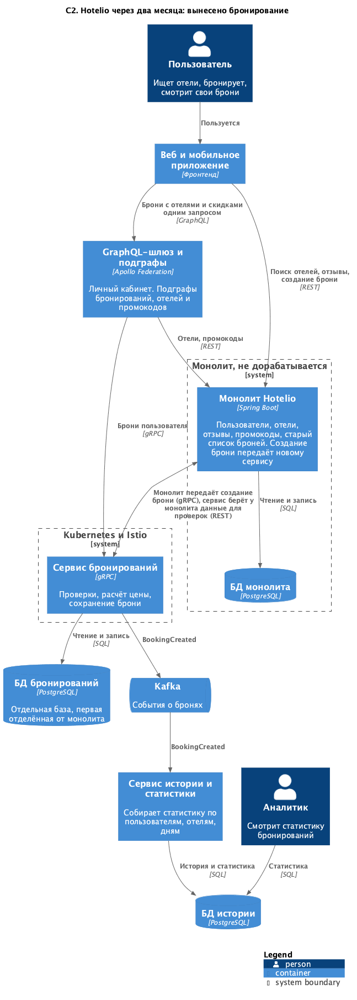

### **Название задачи: Первый модуль - бронирование, план переноса по Strangler Fig**
### **Автор: Никита Соловьёв**
### **Дата: 12.10.2026**

### **Функциональные требования**
Целевое состояние и список проблем - в ADR-001, здесь номера проблем и НФТ оттуда, если не сказано иное.

|**№**|**Действующие лица или системы**|**Use Case**|**Описание**|
| :-: | :- | :- | :- |
|1|Монолит, сервис бронирований|Создание брони|Монолит принимает `POST /api/bookings` как раньше и передаёт его сервису по gRPC. Сервис проверяет, считает цену, сохраняет бронь в свою базу|
|2|Пользователь, монолит|Список броней|Остаётся в монолите и читает старую базу, пока не перенесены данные|
|3|Сервис бронирований, Kafka, сервис истории|Событие о брони|После сохранения уходит `BookingCreated`, сервис истории собирает статистику|
|4|Сервис бронирований, монолит|Данные других модулей|Пользователь, отель, отзывы и промокод запрашиваются через REST монолита|

### **Нефункциональные требования**
Нумерация своя, для этого ADR.

|**№**|**Требование**|
| :-: | :- |
|1|Внешний API монолита не меняется, клиенты переноса не замечают|
|2|Каждый шаг откатывается без релиза кода|
|3|Регрессионные тесты зелёные после каждого шага|
|4|Брони не теряются и не задваиваются при переносе данных|
|5|Данные других модулей сервис получает только через их API, не из чужой базы|
|6|Новые фичи бронирования пишутся только в новом сервисе|

### **Решение**
Перенести всё сразу не можем: бэкенд пишут три человека (НФТ 8 из ADR-001). Начинать надо с одного модуля.
Пользователей не рассматривал: от них зависят все остальные, и их вынос первым затронул бы каждый модуль.

|**Критерий**|**Бронирование**|**Отели**|**Отзывы**|**Промокоды**|
| :- | :- | :- | :- | :- |
|Нагрузка|пик, проблема 2|высокая на чтение, поиск|низкая|низкая|
|Что даёт вынос|отдельное масштабирование главного процесса, место для новых фич|кеширование, можно и без выноса|почти ничего|гибкие акции|
|Зависимости|от всех четырёх модулей|нет|нет|от пользователей|
|Риск переноса|высокий|низкий|низкий|средний|

Выбираю бронирование. Риск у него самый высокий, но только его вынос закрывает проблему 2 и даёт место, куда писать
новые фичи бронирования. Отели вынести проще, и под нагрузкой они тоже. Если бы главной болью был поиск, я бы начинал
с них.

Зависимость от четырёх модулей закрываю временным REST-клиентом к монолиту внутри сервиса. Он один отвечает за то, как
устроен монолит, и защищает модель сервиса от модели монолита (Anti-Corruption Layer). Когда следующие модули
вынесут, поменяется только этот клиент. Выполняем НФТ 5.

Шаги переноса. Первые четыре - это состояние через два месяца из ADR-001, они же сделаны в заданиях 2-5 этого проекта.

1. Сервис бронирований рядом с монолитом. Монолит передаёт создание брони по gRPC, переключение - переменная окружения
`BOOKING_SERVICE_EXTERNAL_HOST`. Список броней в монолите не трогаем. Откат: убрать переменную и перезапустить
монолит. Проверка: регрессионный тест, ответы и коды те же. Выполняем НФТ 1, 2 и 3.
2. Событие `BookingCreated` в Kafka и сервис истории со статистикой для аналитиков. Откат: остановить сервис истории,
бронирование от него не зависит.
3. GraphQL-шлюз для личного кабинета поверх сервиса бронирований и монолита, промокоды отдельным подграфом. Откат:
фронтенд возвращается на REST.
4. Kubernetes, Helm и CI/CD для сервиса бронирований, затем Istio: новая версия получает 10% трафика. Откат: вернуть
весь трафик на старую версию.
5. Перенос старых броней. Разовая выгрузка из базы монолита, затем передача изменений (CDC) до переключения, после
этого список броней переключается на сервис, таблица `booking` удаляется из монолита. Пока таблица не удалена, откат -
снова читать список из монолита. Выполняем НФТ 4.
6. Следующие модули: промокоды, потом отели и отзывы, пользователи последними. Сервис бронирований меняет REST-клиент на
их API.

С шага 1 новых фич в бронировании монолита нет, всё новое пишется в сервисе. Выполняем НФТ 6.

### **Альтернативы**
Начать с отелей или отзывов. Проще и безопаснее, хорошо для отработки процесса. Но главную проблему, масштабирование
бронирования, это не решает.

Перенести сразу и создание, и список. Тогда старые брони нужно перенести до запуска, первый шаг становится большим и
откатить его сложно.

Писать бронь сразу в обе базы, монолита и сервиса. При сбое одной из записей базы разъедутся, и сверять их некому.
Не подходит.

Читать пользователей и отели напрямую из базы монолита. Быстрее, чем REST, но любая правка схемы монолита сломает
сервис, а сама база так и останется общей.

**Недостатки, ограничения, риски**

- Бронирование зависит от монолита: если он недоступен, проверки не пройдут и бронь не создастся.
- Пять REST-вызовов на бронь вместо вызовов в памяти. Задержку надо измерить, проверки можно делать параллельно.
- Событие потеряется, если сервис упадёт между сохранением брони и отправкой в Kafka. Лечится Transactional Outbox, в
первом шаге его нет.
- До шага 5 новые брони не видны в старом списке монолита, только в личном кабинете. Поэтому шаг 5 нельзя надолго
откладывать.
- Проверка «есть ли места» и сохранение не атомарны, при одновременных бронях возможна перебронь. Так было и в монолите.
- Ошибки расчёта брони переносятся как есть, чтобы перенос не менял поведение.
